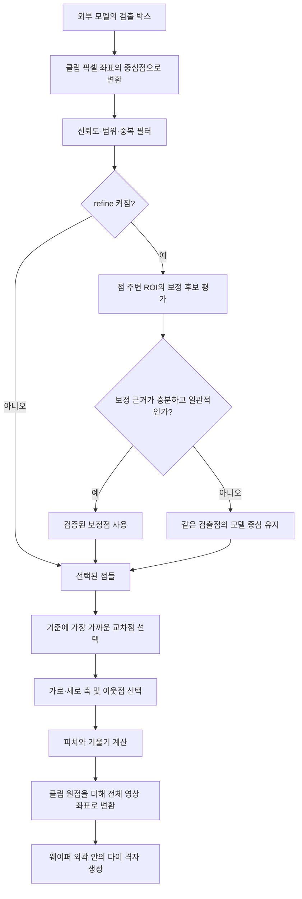

# 검출 중심을 보존하는 격자 보정

이 문서는 `codex/wafer_via.py`의 처리 순서와 불확실한 보정의 반환 규칙을 설명합니다. 모델 실행은 호출 프로그램에서 수행합니다. 이 모듈은 이미 검출된 박스 또는 중심점 배열을 입력받습니다.

## 입력과 출력은 그대로

```python
from codex.wafer_via import build_die_map_from_yolo

dm = build_die_map_from_yolo(
    wafer_image=wafer_bgr,
    clip_image=center_clip_bgr,
    detections=results[0].boxes.xyxy.cpu().numpy(),
    detection_format="xyxy",
    normalized=False,
    refine=True,
)
```

`refine=False`는 이미지로 점 위치를 보정하지 않습니다. `refine=True`는 보정을 시도하되, 불확실하면 그 점의 원래 모델 중심을 그대로 사용합니다. `refine_cross_point()`의 불확실한 반환값은 `(입력 중심점, 0.0)`입니다. 이 신뢰도 0은 **모델 검출이 틀렸다는 뜻이 아니라 영상 보정을 채택하지 않았다는 뜻**입니다.

반환 객체와 좌표계, 기존 인수와 기본값은 유지됩니다. `GridEstimate.refined`는 보정 옵션이 켜졌는지를 나타내는 기존 필드이므로, 모든 점이 실제로 이동했다는 뜻은 아닙니다.

## 보정을 보류하는 조건

- 주변 ROI가 영상 끝에서 잘리거나 원본 Lab 대비가 너무 낮은 경우
- 가장 강한 경계쌍이 ROI 경계에 걸려 양쪽 문맥이 부족한 경우
- 다른 중심을 가리키는 후보의 점수가 최고점의 90% 이상인 경우
- 모델 점을 포함하면서 그 점에 2px 이상 더 가까운 대안이 최고점의 50% 이상 지지받는 경우
- gradient 단독 모드에서 최고점의 경계쌍이 모델 점을 포함하지 않는 경우
- X 또는 Y 중 한 축의 검증이 실패한 경우

각 임계값은 보수적인 채택 규칙이며 정답 확률을 뜻하지 않습니다. 주어진 모델 점이 실제 스트리트 밖에 있다면 기본 버전은 큰 이동을 시도하지 않을 수 있습니다. 반대로 정상 경계가 명확한 작은 오차는 계속 보정합니다.

V7의 `auto`와 `corner_color`는 양축에서 유효한 경계 후보와 색상 후보가 1px 이내로 일치해야 합니다. 한쪽 후보가 없거나 두 후보가 충돌하면 모델 점을 유지합니다. 두 방식이 같은 내부 무늬를 잘못 선택하는 경우를 위해 모델 점을 지지하는 대안 경계도 함께 검사합니다.

## 합성 재현 전후

| 입력 조건 | 모델 중심 | 수정 전 | 수정 후 |
|---|---|---|---|
| 기본 버전, 흰 십자가 옆의 짙은 녹색 띠 | (64,64) | (59,59) | (64,64), confidence 0 |
| 기본 버전, 거의 흰 연초록 띠 | (100,100) | (97.5,97.5) | (100,100), confidence 0 |
| V7 auto, 연초록 띠와 흰 기준 패치 | (100,100) | 약 (92.5,92.5) | (100,100), confidence 0 |

정확한 모델 중심을 의도적으로 입력한 합성 재현입니다. 오류 방향을 바꾼 회전 입력도 검사하며, 항상 원점을 반환하는 변경이 되지 않도록 정상 오프셋의 실제 보정도 함께 검사합니다.

## 전체 흐름



### 1. 박스에서 중심점으로

`xyxy` 입력 `[x1,y1,x2,y2]`의 중심은 `((x1+x2)/2,(y1+y2)/2)`입니다. 이 코드에서 `xywh`의 x,y는 **중심 좌표**입니다. 좌상단 x,y와 폭·높이를 가진 형식과 혼동하면 보정 전부터 좌표가 틀립니다. 픽셀 좌표라면 `normalized=False`를 명시할 수 있습니다.

### 2. 이미지 보정

기본 버전은 각 점 주변의 Lab 경계를 X·Y 방향으로 투영하고, 경계쌍의 중간점을 후보로 계산합니다. 강한 내부 무늬가 실제 십자가 경계보다 높은 점수를 받을 수 있으므로, 단지 가장 높은 점수라는 이유로 점을 옮겨서는 안 됩니다. 불확실한 후보는 원래 점을 반환합니다. 이 수정은 특정 초록색이나 흰색을 고정 임계값으로 지정하지 않습니다.

### 3. 중앙점과 축 이웃

기본 버전은 클립 이미지 중앙에 가장 가까운 점을 기준으로 선택합니다. V7의 전체 파이프라인은 검출한 웨이퍼 중심을 클립 좌표로 옮긴 값을 기준으로 선택합니다. 두 버전 모두 보정 후 점들 중에서 선택하므로, 전후 비교 시 **같은 검출점의 좌표**를 비교해야 합니다. 선택된 중앙점 하나만 비교하면 다른 점으로 재선택된 것을 보정 이동으로 오해할 수 있습니다.

주변 점으로 격자 방향을 추정하고, 그 방향을 기준으로 옆 점과 아래 점을 선택합니다. 기본 버전의 최종 각도는 선택된 두 축으로 계산하고, V7의 기본 `angle_mode="robust"`는 여러 점쌍의 일관성을 사용합니다. notch 파생 버전은 각도를 notch에서 얻으므로 이 부분이 다릅니다.

### 4. 피치와 각도

기준점이 C, 옆 점이 R, 아래 점이 B라면 `pitch_x = ||R-C||`, `pitch_y = ||B-C||`입니다. 이미지 좌표는 아래쪽으로 Y가 증가합니다. 오른쪽 이웃으로 갈수록 Y가 증가하는 격자의 기울기는 양수입니다.

예를 들어 C=(256,256), 가로 피치 80, 세로 피치 90, 기울기 3도라면 다음과 같습니다.

- 가로 축 `u = (cos 3°, sin 3°)`
- 세로 축 `v = (-sin 3°, cos 3°)`
- R = C + 80u ≈ (335.890,260.187)
- B = C + 90v ≈ (251.290,345.877)

이 수치는 설명용 합성 격자이며 실제 모델 성능 측정값이 아닙니다.

### 5. 전체 영상의 격자

전체 영상이 1000×1000이고 클립 원점이 `(244,244)`이면 C의 전체 영상 좌표는 `(500,500)`입니다. 여기서 피치와 두 축 방향으로 격자를 확장합니다. 실제 중앙 crop 위치를 알고 있다면 그 값을 `clip_origin`으로 전달합니다. 모델의 resize나 letterbox가 적용됐다면 먼저 클립 픽셀 좌표로 되돌려야 합니다.

예시에서 실제 웨이퍼 중심이 `(510,490)`이면 V7의 선택 기준은 클립 좌표 `(266,246)`입니다. 기본 버전의 기준 `(256,256)`과 다르지만, 이 예시에서는 두 기준 모두 같은 검출점을 선택합니다.

기본 `wafer_via.py`의 다이 맵은 원본 영상 좌표입니다. V7 base의 `aligned_image`는 별도 회전 영상이므로 맵 좌표를 그대로 그 위에 그리면 안 됩니다. `wafer_via_notch.py` 파생 맵은 정렬 영상 좌표이므로, `coordinate_space` 및 해당 버전 문서를 확인합니다.

## 재현과 검증 범위

`tests/test_refinement_safety.py`는 흰 십자가 주변 녹색 패턴, 방향을 바꾼 입력, 불확실한 보정의 원점 유지와 정상 보정 등을 검사합니다. 실제로 사용자가 오류를 겪은 외부 이미지와 모델은 제공되지 않았으므로, 외부 장비에서의 해결이나 모델 정확도까지 검증한 것은 아닙니다.

```powershell
python -B -m unittest discover -s tests -v
```

보정 안전성은 이웃점 누락, 잘못된 박스 형식, 틀린 clip 원점 등을 해결하는 기능이 아닙니다. 특히 `angle_confidence`만으로 중심점과 피치의 정답 여부를 판단하지 않습니다.
